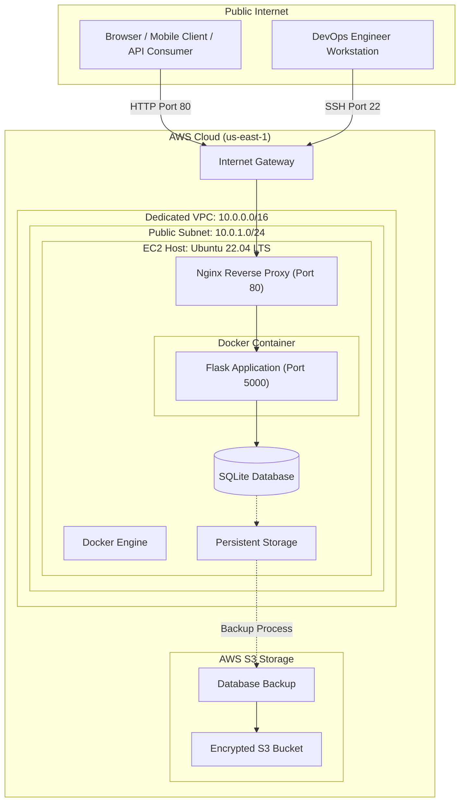

# Architecture Specification: Enterprise Smart Library Management Platform

**Course Module:** Unit 4 – Infrastructure Automation  
**Student Name:** DHOKANE KRUSHNA BABASAHEB  
**PRN:** 2125UMLM1079  
**Cloud Platform:** Amazon Web Services (AWS)  
**Region:** us-east-1  

---

## 1. High-Level System Architecture

The Enterprise Smart Library Management Platform is deployed on Amazon Web Services (AWS) using Terraform and Ansible.

Terraform is responsible for creating the cloud infrastructure, while Ansible automates server configuration and application deployment.

The application runs inside a Docker container on an AWS EC2 instance. Nginx acts as a reverse proxy to handle incoming HTTP requests and forward them to the Flask application.

The SQLite database stores application data, while Amazon S3 provides storage for database backups.

### Architecture Diagram



---

## 2. Component Specifications

### 2.1 Networking Infrastructure (Terraform)

Terraform creates and manages the networking resources required for the application.

**VPC (Virtual Private Cloud)**

- CIDR Block: `10.0.0.0/16`
- Provides an isolated network environment.
- DNS resolution and DNS hostnames are enabled.

**Public Subnet**

- CIDR Block: `10.0.1.0/24`
- Availability Zone: `us-east-1a`
- Automatic public IPv4 address assignment is enabled.

**Internet Gateway**

- Connects the VPC to the internet.
- Allows communication between the public subnet and external networks.

**Route Table**

- Configures the network traffic routes.
- Uses `0.0.0.0/0` as the default internet route through the Internet Gateway.

### 2.2 Security Governance (Security Group)

The security group controls incoming and outgoing network traffic for the EC2 instance.

| Port | Protocol | Purpose |
|---|---|---|
| 22 | TCP | SSH administration |
| 80 | TCP | HTTP web traffic |
| 5000 | TCP | Flask application access |
| All | Outbound | Required external communication |

SSH access should be restricted to the administrator's IP address. Direct application access on port 5000 should also be restricted where possible, since Nginx handles public application traffic.

### 2.3 Compute and Container Layer (EC2 and Docker)

The EC2 instance provides the computing environment for the Library Management Platform.

**Operating System:**
- Ubuntu Server 22.04 LTS.
- Official Ubuntu AMI obtained dynamically through AWS SSM Parameter Store.

**Docker Engine:**
- Used to run the application inside a container.
- Managed through the system service manager.

**Application Framework:**
- Python Flask.
- RESTful API architecture.
- Application port: 5000.

**Persistent Storage:**

The host directory:

```text
/opt/library/data
```

is mounted inside the Docker container to preserve database files even when the container is restarted or recreated.

### 2.4 Ingress Routing Layer (Nginx)

Nginx works as a reverse proxy between external clients and the Flask application.

**Configuration:**

- Listens on HTTP port 80.
- Forwards incoming requests to `http://127.0.0.1:5000`.
- Manages incoming HTTP traffic.

The following headers are forwarded:

| Header | Purpose |
|---|---|
| Host | Original host information |
| X-Real-IP | Client IP address |
| X-Forwarded-For | Forwarded client IP information |
| X-Forwarded-Proto | Original request protocol |

This configuration helps the backend application identify the original client request.

### 2.5 Disaster Recovery and Storage (Amazon S3)

Amazon S3 is used to store database backup files.

**Bucket Naming Convention:**

```text
library-backup-${ACCOUNT_ID}-${REGION}
```

**Storage Configuration:**

- Bucket Versioning: Enabled.
- Server-Side Encryption: AES256.
- Backup Format: SQLite database file.
- Backup Directory: `backups/`.

**Backup Destination:**

```text
s3://<bucket-name>/backups/library.db
```

Versioning helps preserve previous object versions, while server-side encryption provides protection for stored data.

---

## 3. Infrastructure Automation Workflow

The complete deployment follows these steps:

1. Terraform initializes the AWS provider.
2. Terraform provisions networking, security, compute, and storage resources.
3. The EC2 instance becomes available.
4. Ansible connects to the instance using SSH.
5. Ansible installs Docker and Nginx.
6. Ansible configures the reverse proxy.
7. The Flask application is built and deployed inside Docker.
8. SQLite stores the application data.
9. Database backups are uploaded to Amazon S3.
10. Application endpoints and S3 configurations are verified.

---

## 4. Conclusion

The architecture of the Enterprise Smart Library Management Platform demonstrates the integration of Infrastructure as Code and configuration management.

Terraform automates AWS infrastructure provisioning, while Ansible manages server configuration and application deployment.

Docker provides application isolation, Nginx manages incoming HTTP requests, and Amazon S3 provides secure database backup storage.

This architecture provides practical knowledge of cloud networking, infrastructure automation, containerization, reverse proxy configuration, and disaster recovery.

---

**Student Name:** DHOKANE KRUSHNA BABASAHEB  
**PRN:** 2125UMLM1079  
**Module:** Unit 4 – Infrastructure Automation
